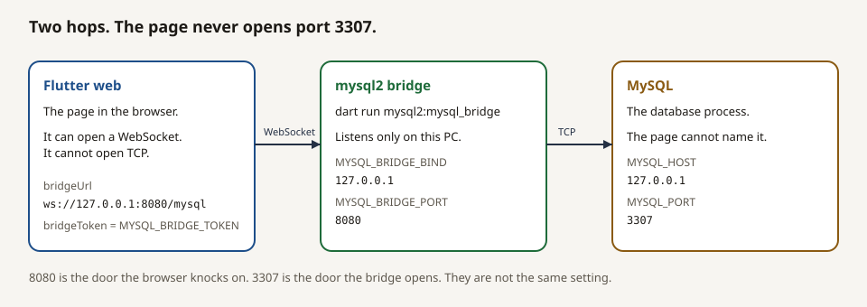
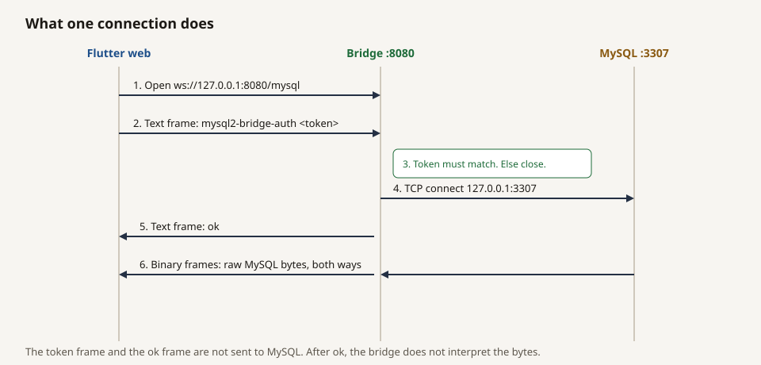

mysql2
======

A MySQL driver for the Dart programming language. Works on Flutter, including
Flutter web, and on the server.

This is the published line of [`mysql1`](https://github.com/adamlofts/mysql1_dart)
with a WebSocket bridge, so an app can depend on it while that support is in
review upstream. The API is the same. Import `package:mysql2/mysql2.dart`.

Principles
----------

- Keep behavior and defaults close to the major MySQL drivers: MySQLdb
  (`mysqlclient`), the C client (`libmysqlclient`), Connector/J and
  `go-sql-driver/mysql`.
- Keep the API similar to `package:postgres`.
- Good defaults.

Usage
-----

Connect to the database

```dart
var settings = new ConnectionSettings(
  host: 'localhost', 
  port: 3306,
  user: 'bob',
  password: 'wibble',
  db: 'mydb'
);
var conn = await MySqlConnection.connect(settings);
```

Execute a query with parameters:

```dart
var userId = 1;
var results = await conn.query('select name, email from users where id = ?', [userId]);
```

Use the results:

```dart
for (var row in results) {
  print('Name: ${row[0]}, email: ${row[1]}');
});
```

Insert some data

```dart
var result = await conn.query('insert into users (name, email, age) values (?, ?, ?)', ['Bob', 'bob@bob.com', 25]);
```

An insert query's results will be empty, but will have an id if there was an auto-increment column in the table:

```dart
print("New user's id: ${result.insertId}");
```

Execute a query with multiple sets of parameters:

```dart
var results = await query.queryMulti(
    'insert into users (name, email, age) values (?, ?, ?)',
    [['Bob', 'bob@bob.com', 25],
    ['Bill', 'bill@bill.com', 26],
    ['Joe', 'joe@joe.com', 37]]);
```

Update some data:

```dart
await conn.query(
    'update users set age=? where name=?',
    [26, 'Bob']);
```

Parameters
----------

Parameters are bound client side. The values are escaped, written into the
statement as literals, and the result is sent as a single query - there is no
server side prepare/execute/close. This is what `mysqlclient` does, and so how
most MySQL deployments already send their statements.

The reason to do it this way is query planning. A bound value is opaque to the
optimizer, so if the leading column of an index is a parameter it takes ref
access on that column and never builds a range, and a keyset page can degrade
into a scan.

Flutter Web
-----------

A page cannot open a TCP socket, so it cannot connect to MySQL's port on its
own. No change in this package removes that: browsers withhold raw sockets on
purpose, and a web app which could open port 3306 could also open every other
port of every machine the user can reach. The protocol code is the same. On
the web those bytes are carried over a WebSocket to a bridge, and the bridge
is what opens the database connection.

The bridge connects only to the host it was started with. The page does not
get to choose the address.

There are two addresses, and they are not interchangeable.

* `MYSQL_BRIDGE_BIND` and `MYSQL_BRIDGE_PORT` are the WebSocket. That is the
  URL the page puts in `bridgeUrl`.
* `MYSQL_HOST` and `MYSQL_PORT` are MySQL. Only the bridge dials them. The
  page never sends them, and `ConnectionSettings.host` / `port` are not used
  on this path.



This is the configuration those boxes are drawn from. MySQL is on the same
computer as the bridge, but on port **3307** rather than the default 3306.
The WebSocket listens on **127.0.0.1:8080**, so only a browser on that same
computer can open it. In PowerShell, in the terminal that will run the
bridge, and before the command:

```powershell
$env:MYSQL_BRIDGE_TOKEN = 'a-long-random-secret'
$env:MYSQL_HOST = '127.0.0.1'
$env:MYSQL_PORT = '3307'
$env:MYSQL_BRIDGE_BIND = '127.0.0.1'
$env:MYSQL_BRIDGE_PORT = '8080'

dart run mysql2:mysql_bridge
```

`$env:` lasts for that terminal only. Closing it clears the variables. The
token line is required: without it the process exits and does not listen.
The value has to be at least 16 characters, and it is never printed.

When the process stays up it prints two lines, and not the token:

```
mysql2 bridge listening on ws://127.0.0.1:8080/mysql
forwarding to 127.0.0.1:3307
```

The first line is what the page connects to. The second line is the database
the bridge will open. Copy the first line into `bridgeUrl`.

### What each variable does

**`MYSQL_BRIDGE_TOKEN`** is the secret the page must send before the bridge
opens MySQL. It is required, at least 16 characters. The page puts the same
value in `ConnectionSettings.bridgeToken`. A wrong token closes the WebSocket
and the bridge does not dial MySQL. Anyone who can load the built web app can
read this value, the database user and the password.

**`MYSQL_HOST`** is the host **the bridge** connects to. It is not the host
the browser connects to. `127.0.0.1` means MySQL is on the same computer as
the bridge. If MySQL were on another machine, this would be that machine's
address, and only the bridge would need to reach it. The default is
`127.0.0.1`. The page cannot override it.

**`MYSQL_PORT`** is the TCP port **the bridge** dials. `3307` means MySQL on
that computer is not on the usual 3306. Leave this unset and the bridge dials
3306, so the connection fails even when MySQL is up on 3307. The default is
`3306`. The Flutter app does not pass 3307 anywhere.

**`MYSQL_BRIDGE_BIND`** is the interface the WebSocket listens on.
`127.0.0.1` means only programs on this computer can open it: another PC, a
phone, or a deployed site cannot. That is the default, and the right value
while you are developing. `0.0.0.0` listens on every interface of the machine.
Do that only when the people who can open the socket are the people who
should be able to log in, because the token is inside the web app.

**`MYSQL_BRIDGE_PORT`** is the port of that WebSocket. `8080` is why the page
uses `ws://127.0.0.1:8080/mysql`. It is not MySQL's port. The default is
`8080`. The path is always `/mysql`. A different path is not upgraded to a
WebSocket.

**`MYSQL_BRIDGE_ORIGIN`** is optional, and it is not set in the block above.
When it is set, the bridge upgrades only a browser request whose `Origin`
header is exactly this value, for example `http://localhost:1234`. When it is
unset, any page that can open the socket and knows the token is accepted.
With bind `127.0.0.1`, only a page on this computer can open the socket.

| Variable | In the example | Which hop it is | If you leave it unset |
| --- | --- | --- | --- |
| `MYSQL_BRIDGE_TOKEN` | `a-long-random-secret` | The page must present it | The bridge exits and does not listen |
| `MYSQL_HOST` | `127.0.0.1` | Bridge to MySQL | `127.0.0.1` |
| `MYSQL_PORT` | `3307` | Bridge to MySQL | `3306`, which is the wrong port here |
| `MYSQL_BRIDGE_BIND` | `127.0.0.1` | Page to bridge | `127.0.0.1`, this computer only |
| `MYSQL_BRIDGE_PORT` | `8080` | Page to bridge | `8080` |
| `MYSQL_BRIDGE_ORIGIN` | unset | Which site may connect | Any origin that can open the socket |

### What the page sets

`bridgeUrl` is built from the bind address, the bridge port, and the fixed
path. For the values above it is `ws://127.0.0.1:8080/mysql`. `localhost` is
the same place when the browser is on that computer. `bridgeToken` is
`MYSQL_BRIDGE_TOKEN`. `user`, `password` and `db` are still the MySQL account:
they travel inside the protocol after the bridge has said `ok`. `host` and
`port` on `ConnectionSettings` are not consulted.

```dart
var conn = await MySqlConnection.connect(ConnectionSettings(
  user: 'bob',
  password: 'wibble',
  db: 'mydb',
  bridgeUrl: 'ws://127.0.0.1:8080/mysql',
  bridgeToken: 'a-long-random-secret',
));
```

`example/example_web.dart` is the same calls as `example/example.dart`, aimed
at this bridge. Run the bridge first, then the example.

### One connection, in order



1. The page opens `ws://127.0.0.1:8080/mysql`.
2. It sends one text frame, `mysql2-bridge-auth` followed by a space and the
   token. That frame is not forwarded.
3. The bridge compares the token. A mismatch closes the socket. MySQL is not
   dialed.
4. The bridge opens TCP to `127.0.0.1:3307`, the host and port from its own
   environment.
5. It replies with the text frame `ok`.
6. After that, every binary frame is raw MySQL protocol, in both directions.
   The bridge does not read queries or results. It copies bytes.

`useSSL` stays off on that connection. The browser cannot perform MySQL's TLS
upgrade, and the bridge only copies bytes, so it cannot perform it either.
Use `wss://` when the bridge is not on the same machine as the browser. A
page served with HTTPS cannot open a `ws://` URL. An account using
`caching_sha2_password` which has not logged in from the bridge's address
before needs `serverPublicKey`, because the password would otherwise have to
travel inside MySQL's TLS upgrade.

`user`, `password` and `bridgeToken` are part of the built web app. Anyone
who can load the app can read them and use the bridge. Give that database
user only what the app needs, and leave the bridge on loopback unless the
people who can open it are the people who should be able to log in.

On a server, on Flutter mobile and on the desktop, `connect` still opens a
socket to `host` and `port`. `bridgeUrl` is not required there. Setting it
uses the bridge from those targets too. A unix socket is not available from
the browser: the bridge itself connects to MySQL over TCP.
